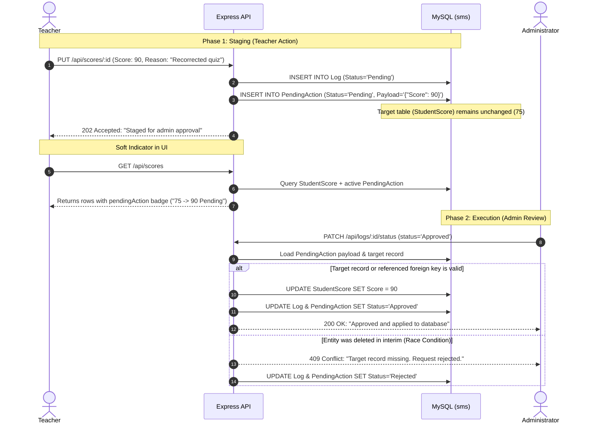

# Implementation Plan: Two-Phase Deferred Approval & Section Permissions

## Goal Description
Transform the system from an *optimistic audit-log* model to a **two-phase deferred execution model** for critical teacher actions:
1. When a teacher performs an action requiring a reason (edit/delete grade item, edit/delete student grade, delete student), the database is **not** modified immediately. Instead, a staged change is recorded in a new `PendingAction` table and `Log` entry.
2. The UI uses **soft pending indicators** (badges and diffs) on affected records so teachers immediately see their changes are staged awaiting approval, eliminating the "pending edit UI dilemma".
3. When an Administrator approves the request in the Audit Log, the server executes the staged SQL change on the target table. If race conditions occurred (e.g., the target or parent record was deleted in the interim), the system catches the foreign key / missing entity error gracefully and rejects the stale request without crashing.
4. If an Administrator rejects the request, the target table remains completely untouched and the pending badge is cleared.
5. Sections are changed to **Admin-only write access** (`writeRoles: ['Admin']`), matching realistic university administration workflows.

---

## User Review Required

> [!IMPORTANT]
> **Database Schema Evolution (Table #13: `PendingAction`)**:
> We will add the `PendingAction` table to [student_management_system_db.sql](file:///home/excalibur/programming-projects/student_management_system/student_management_system_db.sql) and the live Aiven MySQL database. This cleanly encapsulates unapproved payloads (JSON/text) without mutating original table records or overloading the `Log` table.

> [!NOTE]
> **Section Management Role Transition**:
> Setting sections to Admin-only write means teachers will no longer see "Add Section", "Edit Section", or "Delete Section" buttons. Sections must be created and assigned by an Admin.

---

## Architecture & Workflow



---

## Proposed Changes

### Database Schema

#### [MODIFY] `student_management_system_db.sql`
Add the `PendingAction` table definition and foreign key constraints:
```sql
CREATE TABLE `PendingAction` (
  `PendingActionID` int PRIMARY KEY AUTO_INCREMENT,
  `LogID` int NOT NULL,
  `TeacherID` int NOT NULL,
  `ActionType` varchar(10) NOT NULL,
  `TargetTable` varchar(30) NOT NULL,
  `TargetID` int NOT NULL,
  `Payload` text,
  `Reason` varchar(255) NOT NULL,
  `Status` varchar(20) DEFAULT 'Pending',
  `CreatedAt` datetime DEFAULT (CURRENT_TIMESTAMP)
);

ALTER TABLE `PendingAction` ADD FOREIGN KEY (`LogID`) REFERENCES `Log` (`LogID`) ON DELETE CASCADE;
ALTER TABLE `PendingAction` ADD FOREIGN KEY (`TeacherID`) REFERENCES `Teacher` (`TeacherID`);
```

#### [MODIFY] `server/scripts/initDb.js`, `server/scripts/checkDb.js`, `server/scripts/clearData.js`
- Update table checking to include `PendingAction` (13 tables total).
- Update `clearData.js` to truncate `PendingAction` when resetting data.

---

### Backend API

#### [MODIFY] `server/src/resources.js`
1. **Sections Write Role**: Change `writeRoles` on `sections` from `['Teacher', 'Admin']` to `['Admin']`. Remove `requiresReasonOnDelete` for teachers on sections (Admins can manage directly).
2. **Pre-Approval Staging Logic**:
   - For resources requiring approval (`assessments`, `scores`, `students` on delete):
   - When a Teacher submits a sensitive change, do **not** run `UPDATE` or `DELETE` directly.
   - Instead, write a `Log` entry (`Status = 'Pending'`) and insert into `PendingAction` (`TargetTable`, `TargetID`, `ActionType`, `Payload: JSON.stringify(values)`, `Reason`, `TeacherID`).
   - Return `{ message: "Action submitted and awaiting administrator approval.", pending: true, logId }`.

#### [MODIFY] `server/src/routes/resources.js`
- In `GET /api/:resource`: Join or query active pending actions for the resource's rows (`WHERE Status = 'Pending'`), attaching `pendingAction` metadata (e.g. `_pending: { ActionType, Payload, Reason }`).

#### [MODIFY] `server/src/index.js`
- Enhance `PATCH /api/logs/:id/status`:
  - When Admin approves a `Log` entry:
    - Check if a matching `PendingAction` exists.
    - If found:
      - Begin a database transaction.
      - Verify that `TargetID` still exists in `TargetTable`.
      - If missing or parent entity missing: throw error, roll back, mark `Log` as `Rejected`, and inform Admin: `"Target record or relation no longer exists in database."`
      - If valid: apply the `UPDATE` or `DELETE` query to the target table.
      - Update `PendingAction.Status = 'Approved'`.
      - Commit transaction.
  - When Admin rejects:
    - Update `PendingAction.Status = 'Rejected'`.
    - No query touches the target table.

---

### Frontend UI

#### [MODIFY] `client/src/resourceConfigs.jsx`
- Update `sections.writeRoles` to `['Admin']`.

#### [MODIFY] `client/src/components/ResourcePage.jsx`
1. **Soft Flag Badges & Proposed Value Indicators**:
   - For rows with `row._pending`:
     - If `_pending.ActionType === 'DELETE'`: render a warning badge `⏳ Pending Deletion` and disable Edit/Delete actions.
     - If `_pending.ActionType === 'UPDATE'`: render a badge `⏳ Pending Edit` and show the proposed change (e.g., in `scores`, display `75.00 → 95.00 (Pending)`).
2. **Audit Log Review Enhancement**:
   - In `/logs`, for entries that have a pending action payload, show a "View Staged Change" pill so the Admin can see exactly what query/values will be applied upon clicking "Approve".

#### [MODIFY] `client/src/styles.css`
- Add styles for `.pending-badge`, `.pending-diff`, and `.row-pending-delete`.

---

## Verification Plan

### Automated Tests
Run dedicated verification script `server/scripts/testPendingApproval.js`:
1. **Teacher stages edit**: Teacher updates a score from 50 to 90 with a reason. Verify target table still has 50. Verify `PendingAction` and `Log` have pending records.
2. **Soft flag retrieval**: Call `GET /api/scores` as Teacher, verify row contains `_pending` object with new score 90.
3. **Admin approval execution**: Admin approves `Log`. Verify database now contains score 90 and `PendingAction` is approved.
4. **Race condition test**: Stage a deletion for a student, manually delete the section first, then attempt to approve student deletion. Verify API gracefully catches missing reference, marks log rejected, and returns explanatory message.
5. **Admin-only sections check**: Verify teacher receives `403 Forbidden` if attempting `POST /api/sections`.

### Manual Verification
1. Log in as **Teacher** (`teacher@sunnycampus.test`):
   - Notice Sections page no longer has an "Add Section" button.
   - Go to Student Grades, edit a score and supply a reason.
   - Verify notice: *"Submitted for administrator approval"*.
   - Verify table immediately shows the pending edit badge and the new proposed score.
2. Log in as **Admin** (`admin@sunnycampus.test`):
   - Go to Audit Logs.
   - Filter by `Pending Review`.
   - See the staged edit and teacher's reason.
   - Click "Approved" $\rightarrow$ Verify status changes to Approved and the grade is updated.
   - Test "Rejected" on another item $\rightarrow$ Verify target table is never modified.
